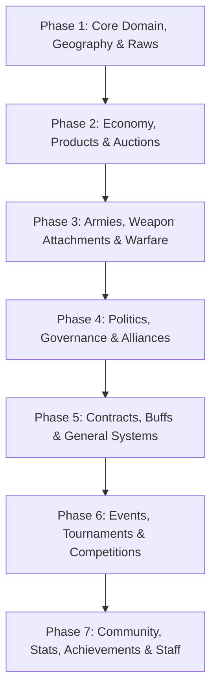

# NationForge Master Implementation Plan

> **Based on Official Game Wiki & Design Specification**  
> *Target Stack: Next.js 14 App Router, NestJS 10, PostgreSQL 16 (Prisma), Redis 7, Socket.io, Tailwind CSS*

---

## 1. Executive Summary & Gap Analysis

NationForge is an open-source MMO social-strategy browser game inspired by e-Sim and eGeopolis. This plan cross-references the current codebase against the complete game wiki, identifying implemented foundations, partial features needing adjustment, and missing systems required for 100% specification compliance.

### System Comparison Matrix

| System / Category | Current Status | Wiki Target Specification | Gap & Action Required |
|---|---|---|---|
| **Raw Materials** | Partial (6 raws: Grain, Iron, Diamond, Oil, Wood, Stone) | **6 Raws**: Grain, Sugar, Gunpowder, Stone, Wood, Petrol | Replace Iron/Diamond/Oil with Sugar/Gunpowder/Petrol across core constants & DB |
| **Products & Ratios** | Partial (Food, Weapon, Gift, Ticket, House, Estate, Hosp, DS, Medkit) | **10 Products**: Ammo (Q1, Q5), Food (Q1-Q5), Energy Drink (Q1-Q5), Pantry, Fridge, Military Air Base (Q1-Q5), Military Navy Base (Q1-Q5), Fortification (Q1-Q5), Hospital (Q1-Q5), Ticket (Economy, First Class) | Align product enums, production ratios, HP restores (Food & Energy Drink), and new military infrastructure (MAB, MNB, Fortification, Hospital) |
| **Daily Limits & Day Change** | Partial (Food/Gift limits + HP consume) | Base 20 Food + 20 Energy Drink; Pantry (+10 food) & Fridge (+10 ED) 60d durability; 1/1 + 100HP hourly regen; Ad +5 food | Implement Pantry/Fridge inventory & decay, separate Energy Drink limits, hourly 1/1+100HP regen worker, Ad bonus |
| **Buffs (1g each)** | Missing | 4 Buffs: Steroid (+10% dmg), Rambo (+10% Q5 ammo), Patriot (+10% core defense), Rebel (+10% core RW) with 24h/48h debuffs | Create Buff model, activation endpoint, fight formula modifiers, debuff expiration cron |
| **Special Items** | Partial (Gear parameters) | Adrenalin Rush (1h/10h/24h double crit), Matrix (10/25/50% dodge), Upgrade (+10% WA param range) | Implement SpecialItem models, auction-only sourcing, combat engine integration |
| **Contracts System** | Missing | Money Loans (amount, duration, interest % auto-calc), Pack Sales, public transaction log, Staff debt cancel | Create Contract model, proposal/acceptance flow, debt tracker, public ledger feed |
| **Damage Ranks & Levels** | Partial (20 generic ranks, 22 levels) | **40 Ranks** (Civil to Generalissimus, +1% dmg/rank), **51 Levels** (5g reward from L9, referral share from L13) | Update `constants.ts` with exact 40 ranks and 51 XP thresholds, level-up rewards, and referral thresholds |
| **Medals System** | Partial (7 medals) | **11 Medals** (5g each): CP, Congress, Party Pres, Round Hero, Battle Hero, RW, Train Addict (30d), Work Addict (30d), Inviter (10 at L13), Events, Game Builder | Add missing medals, streak tracking for 30d work/train, 5g payout per medal |
| **Auctions System** | Missing | Dedicated auction house for Weapon Attachments & Special Items: 1–48h, 1% list fee, 2% sale fee, 3% min outbid, **30s sniper rollback** | Create Auction model, bid engine with Redis locks, auto-extension within last 30s |
| **Companies for Sale** | Missing | List companies for 70%–100% of creation/upgrade value | Add marketplace tab & endpoints for buying/selling existing companies |
| **Stock Companies (JSC)** | Partial (Shares, limit orders, dividends) | Min L13; 1% share buy fee; CEO/Shareholder voting (50%+1); Manager roles: Company, Monetary, Marketplace | Add role delegation, 1% buy tax, shareholder voting engine, 30d inactive share selloff |
| **Embargos** | Missing | 3 Types: Marketplace, Job, Monetary. 30d, 10g from National Org, MoE law, ally immunity, 10g cancel | Implement embargo models, trade/job/FX block checks, law proposals |
| **Countries & Map** | Partial (221 real countries, 6 regions) | **54 Playable** (7 regions: 1 capital, 2 raw, 4 non-raw) + **13 Neutral** (5-6 regions, middle Gunpowder) + **1 Staff** (Antarctic Prison) | Restructure country catalog into 54 Playable, 13 Neutral, 1 Staff; enforce 7 regions per playable country |
| **National Organisations** | Partial (Country treasury) | Dedicated NO account managed by CP/Ministers; tax receipts; direct supply donation to fighters; law fee source | Add National Organisation entity with separate supply storage, budget, and direct fighter donations |
| **Politics & Governance** | Partial (Parties, 30-day elections, basic laws) | **5 Fixed Parties**; CP Cabinet (vCP, MoD, MoE); **18 Law Types**; Alliance system (max 5 countries, Alliance order); Civil War unrest (33.3% vote, 15 rounds); Citizenship request (30g, 10/mo) | Implement 5 fixed party archetype, cabinet assignment, 18 law types, alliances, unrest voting |
| **Armies (Military Units)** | Partial (Creation, join, armory vault, distribute) | 5g create; 4 Ranks: Rookie (5%), Amateur (10%), Experienced (15%), Elite (20%); slot expand fees; 3d join cooldown; 3d WA storage gate; privileges; auto-supply salary | Align costs & ranks, add 3-day join cooldown, privilege flags, supply salary worker |
| **Weapon Attachments (Equipment)** | Partial (8 slots, generic params) | 8 Slots: Muzzle, Laser, Optic, Stock, Rear grip, Magazine, Barrel, Underbarrel; 9 Params; WA Dealer (merge 3→1 + fee, split 1→2 with exact prob table); Upgrades; Decay | Overhaul equipment model with exact 9 params, WA dealer merge/split mechanics, drop hit milestones |
| **Combat & Warfare** | Partial (Battles, rounds, live wall) | 15 rounds max (8 to win), 1h rounds (CW 2h); 24h attack window & initiative; region conquest production bonuses; Training Yard; Battle Drops | Update round timers, conqueror production multipliers, Training Yard practice battle, drop triggers |
| **Events & Tournaments** | Missing | 7 Tournaments (Gunpowder Cup, Global War, Army Cup, Country Cup, Quickdrop, 1v1, FAK Tourney) + Holidays (Halloween), King of the Hill, Patriot Week | Build tournament engine, bracket generator, automated monthly/yearly rewards |
| **Community & Media** | Partial (Newspapers, articles, shouts) | News Portals (L13, 50g, editors, 1g/100 views, 5 art/day, 4 categories); eSocialis network; Referral engine (5g at L9, 0.5g/lvl, 0.5g/medal) | Add editor assignment, view monetisation, eSocialis profile linking, referral payouts |
| **Statistics Engine** | Partial (Leaderboards) | Daily, monthly, all-time stats for Country, Army, Citizen, Alliance, Stock Company, News Portal; war history; permanent attribution | Build statistics aggregation service and analytics dashboards |
| **Staff & Moderation** | Missing | Antarctic Prison country; Police Dept ranks (Officer, Inspector, Special Agent, Director); public shared IP logs; debt cancel | Add staff roles, Prison country, shared IP registry, admin moderation deck |
| **Achievements System** | Missing | 10 Subcategories: Military, Economy, Medals, Inviter, Community, Politics, Game Support, Events, General, WA. 2g reward per subcategory | Build event-driven achievement tracker with automated 2g reward granting |
| **UI & UX Enhancements** | Partial (Top bar nav, national chat) | Customizable 5-shortcut hotlist on sidebar; In-game tutorial with 3 guides (man, woman, chicken); Like/Dislike rating | Implement customizable quick hotlist, interactive tutorial system, entity rating widgets |

---

## 2. Architecture & Database Schema Extensions

### 2.1 Prisma Schema Additions (`apps/api/prisma/schema.prisma`)

```prisma
// --- RAW & PRODUCT ALIGNMENT ---
enum Product {
  // 6 Raws
  GRAIN
  SUGAR
  GUNPOWDER
  STONE
  WOOD
  PETROL
  // 10 Products
  FOOD
  ENERGY_DRINK
  AMMO
  PANTRY
  FRIDGE
  HOSPITAL
  FORTIFICATION
  MILITARY_AIR_BASE
  MILITARY_NAVY_BASE
  TICKET
}

// --- SPECIAL ITEMS & BUFFS ---
enum SpecialItemType {
  ADRENALIN_RUSH_1H
  ADRENALIN_RUSH_10H
  ADRENALIN_RUSH_24H
  MATRIX_10
  MATRIX_25
  MATRIX_50
  UPGRADE
}

model SpecialItemInventory {
  id        String          @id @default(cuid())
  citizenId String
  itemType  SpecialItemType
  quantity  Int             @default(1)
  expiresAt DateTime?

  citizen Citizen @relation(fields: [citizenId], references: [id])
  @@index([citizenId])
}

enum BuffType {
  STEROID
  RAMBO
  PATRIOT
  REBEL
}

model CitizenBuff {
  id        String   @id @default(cuid())
  citizenId String
  type      BuffType
  activeAt  DateTime @default(now())
  expiresAt DateTime // 24h buff duration
  debuffUntil DateTime // 24h (prem) or 48h (non-prem) debuff duration

  citizen Citizen @relation(fields: [citizenId], references: [id])
  @@index([citizenId, expiresAt])
}

// --- CONTRACTS & LOANS ---
enum ContractType {
  LOAN
  PACK_SALE
}

enum ContractStatus {
  PROPOSED
  ACTIVE
  SETTLED
  CANCELLED_BY_STAFF
}

model Contract {
  id           String         @id @default(cuid())
  type         ContractType
  status       ContractStatus @default(PROPOSED)
  creatorId    String
  partnerId    String
  amountGold   BigInt         @default(0) // Loan principal or pack cost in cents
  interestRate Float          @default(0) // Interest in %
  totalDueGold BigInt         @default(0) // Principal + interest
  durationDays Int            @default(7)
  dueAt        DateTime?
  meta         Json?          // Pack details or terms
  createdAt    DateTime       @default(now())
  settledAt    DateTime?

  creator Citizen @relation("ContractCreator", fields: [creatorId], references: [id])
  partner Citizen @relation("ContractPartner", fields: [partnerId], references: [id])
  @@index([creatorId, partnerId])
}

model PublicTransactionAudit {
  id         String   @id @default(cuid())
  actor1Id   String
  actor2Id   String
  actionType String   // "CONTRACT_LOAN", "MARKET_TRADE", "DONATION"
  createdAt  DateTime @default(now())

  @@index([createdAt])
}

// --- AUCTION HOUSE ---
enum AuctionItemType {
  WEAPON_ATTACHMENT
  SPECIAL_ITEM
}

enum AuctionStatus {
  ACTIVE
  COMPLETED
  CANCELLED
}

model AuctionOffer {
  id           String          @id @default(cuid())
  sellerId     String
  itemType     AuctionItemType
  waId         String?         // Weapon attachment reference
  specialItem  SpecialItemType?
  startingBid  BigInt
  currentBid   BigInt
  topBidderId  String?
  endsAt       DateTime
  status       AuctionStatus   @default(ACTIVE)
  createdAt    DateTime        @default(now())

  seller Citizen @relation("AuctionSeller", fields: [sellerId], references: [id])
  topBidder Citizen? @relation("AuctionBidder", fields: [topBidderId], references: [id])
  @@index([status, endsAt])
}

// --- EMBARGOS ---
enum EmbargoType {
  MARKETPLACE
  JOB
  MONETARY
}

model CountryEmbargo {
  id             String      @id @default(cuid())
  fromCountryId  String
  toCountryId    String
  type           EmbargoType
  active         Boolean     @default(true)
  endsAt         DateTime
  createdAt      DateTime    @default(now())

  fromCountry Country @relation("EmbargoFrom", fields: [fromCountryId], references: [id])
  toCountry   Country @relation("EmbargoTo", fields: [toCountryId], references: [id])
  @@unique([fromCountryId, toCountryId, type])
}

// --- ALLIANCES ---
model Alliance {
  id          String   @id @default(cuid())
  name        String   @unique
  leaderId    String?  // Country ID of leader
  viceLeaderId String? // Country ID of vice leader
  activeOrderId String? // Priority battle ID
  createdAt   DateTime @default(now())

  members AllianceMember[]
}

model AllianceMember {
  allianceId String
  countryId  String @unique
  joinedAt   DateTime @default(now())

  alliance Alliance @relation(fields: [allianceId], references: [id])
  country  Country  @relation(fields: [countryId], references: [id])
}

// --- NATIONAL ORGANISATIONS ---
model NationalOrganisation {
  id           String   @id @default(cuid())
  countryId    String   @unique
  treasuryGold BigInt   @default(0)
  treasuryFiat BigInt   @default(0)
  createdAt    DateTime @default(now())

  country Country @relation(fields: [countryId], references: [id])
}

// --- RATINGS ---
model EntityRating {
  id         String   @id @default(cuid())
  voterId    String
  targetType String   // "CITIZEN", "STOCK_COMPANY", "NEWS_PORTAL"
  targetId   String
  isLike     Boolean
  createdAt  DateTime @default(now())

  @@unique([voterId, targetType, targetId])
  @@index([targetType, targetId])
}

// --- ACHIEVEMENTS ---
model CitizenAchievement {
  id          String   @id @default(cuid())
  citizenId   String
  category    String   // "MILITARY", "ECONOMY", "MEDALS", "INVITER", "COMMUNITY", "POLITICS", "GAME_SUPPORT", "EVENTS", "GENERAL", "WEAPON_ATTACHMENTS"
  code        String
  completedAt DateTime @default(now())

  citizen Citizen @relation(fields: [citizenId], references: [id])
  @@unique([citizenId, code])
  @@index([citizenId, category])
}

model AchievementCategoryReward {
  id          String   @id @default(cuid())
  citizenId   String
  category    String
  rewardedAt  DateTime @default(now())

  @@unique([citizenId, category])
}

// --- STAFF & POLICE DEPARTMENT ---
enum StaffRank {
  POLICE_OFFICER
  INSPECTOR
  SPECIAL_AGENT
  DIRECTOR
}

model StaffMember {
  citizenId String    @id
  rank      StaffRank
  badge     String
  grantedAt DateTime  @default(now())

  citizen Citizen @relation(fields: [citizenId], references: [id])
}
```

---

## 3. Detailed Specification by Category

### Category 1: General Systems & Mechanics
- [ ] **Tutorial System**:
  - Profile settings selector for Guide character (`MAN`, `WOMAN`, `CHICKEN`).
  - Toggle switch in profile settings (`enableTutorial: boolean`).
  - Contextual banner/modal guides on `/dashboard`, `/fight`, and navbar subcategories.
  - Step 1 onboarding: Official community Discord link & team play guide.
- [ ] **Customizable Sidebar Hotlist (5 Shortcuts)**:
  - User settings store array of up to 5 route keys in `Citizen.shortcuts`.
  - UI sidebar/topbar quick-dock rendering the 5 selected shortcuts with quick edit modal.
- [ ] **Contracts & Loans Engine**:
  - Money Loan flow: Principal amount, duration (days), interest rate % with auto-calculated total in gold.
  - Pack Sale contracts: Pack selector (Bronze, Silver, Gold). Purchaser cannot originate proposal.
  - Debt settlement: Borrower Repay button. Only Staff members hold permissions to cancel debts.
  - Public transaction audit log: Feed showing `"Player X and Player Y had a transaction"` without disclosing secret figures.
- [ ] **Buffs Engine**:
  - `Steroid Buff` (1g): +10% damage for 24h $\rightarrow$ -10% damage penalty for next 24h (premium) or 48h (non-premium).
  - `Rambo Buff` (1g): +10% damage with Q5 Ammo for 24h $\rightarrow$ Ammo usage locked for next 24h (prem) / 48h (non-prem).
  - `Patriot Buff` (1g): +10% damage defending core region for 24h $\rightarrow$ -10% damage in all battles next 24h/48h.
  - `Rebel Buff` (1g): +10% damage in Resistance War on core region for 24h $\rightarrow$ -10% damage next 24h/48h.
  - Integration into `formulas.ts` hit calculation and BullMQ expiration cron.
- [ ] **Day Change & Regenerative Limits**:
  - Scheduled daily cron at `00:00 CET`:
    - Resets daily limits to base 20 Food + 20 Energy Drinks.
    - Adds Pantry bonus (+10 Food) and Fridge bonus (+10 Energy Drink) if owned and active.
    - Daily work, train, and 20 worker limits reset.
  - Hourly worker: Restores +1 Food limit, +1 Energy Drink limit, and +100 HP every hour.
  - Ad Reward: 1-click once-per-day grant of +5 Food limits.
- [ ] **Special Items Integration**:
  - `Adrenalin Rush`: 1h, 10h, and 24h variants. Doubles headshot (crit) rate during battle hits.
  - `Matrix`: 10%, 25%, and 50% variants. Grants bullet dodge chance (max total 50%), preventing HP loss when hitting.
  - `Upgrade`: Increases Weapon Attachment parameter by 10% of total quality range.
  - Sourcing restriction: Available solely via Auction House and battle drops.
- [ ] **Shared IP Accounts Registry**:
  - Registration option: `Shared IP registration` (inputting nickname of 2nd account on same IP).
  - Max limit of 2 accounts per IP (1 main, 1 shared).
  - Enforce rule: Shared IP accounts cannot be referrals to each other or anyone.
  - Public logs and shared IP registry view.
- [ ] **Damage Ranks & Levels Overhaul**:
  - Implement full 40 damage ranks (Rank 1: 100 Civil $\rightarrow$ Rank 40: 100kk Generalissimus).
  - Exact +1% damage boost per rank up.
  - Implement full 51 level XP milestones (Level 1: 1-9 XP $\rightarrow$ Level 51: 1,160,000+ XP).
  - Grant 5g per level up starting from Level 9.
  - Enable referral gold sharing starting from Level 13.
- [ ] **Medals & Rating System**:
  - Align all 11 medals (5g reward each).
  - Implement 30-day streak tracking for Train Addict and Work Addict.
  - Like/Dislike ratings for Citizens, Stock Companies, and News Portals (gated to Level 13+).
- [ ] **Goldbuying, Packs & Cosmetics**:
  - Pack purchase simulation / payment gateway: Bronze, Silver, Gold packs (FAKs, Gold, Premium days).
  - Cosmetic items: Avatar accessories, colored nicknames, custom profile & newspaper backgrounds.

---

### Category 2: Economy & Market Systems
- [ ] **Raw & Product Supply Chain Alignment**:
  - **6 Raws**: Grain, Sugar, Gunpowder, Stone, Wood, Petrol.
  - **10 Products**:
    - Ammo (from Gunpowder; Q1: 2 gunpowder, Q5: 10 gunpowder).
    - Food (from Grain; 1 grain/Q; restores 10 HP/Q).
    - Energy Drink (from Sugar; 2 sugar/Q; restores 10 HP/Q).
    - Pantry (from Wood; 1000 wood; +10 Food limit; 60d durability).
    - Fridge (from Stone; 2000 stone; +10 Energy Drink limit; 60d durability).
    - Hospital (from Stone; 300 stone/Q; +1 Food & +1 Energy Drink limit/Q).
    - Fortification (from Stone; 300 stone/Q; +3% bonus damage/Q in battle round).
    - Military Air Base (from Wood; 1500 wood/Q; grants borders to 2 neighbor regions).
    - Military Naval Base (from Stone; 1500 stone/Q; grants borders to other port regions).
    - Ticket (from Petrol; 4 petrol for Economy Q1 with -50 HP loss, 20 petrol for First Class Q5 with 0 HP loss).
- [ ] **Auction House Engine**:
  - Sourcing for Weapon Attachments and Special Items (Adrenalin Rush, Matrix, Upgrade).
  - Offer duration: 1 to 48 hours.
  - Fees: 1% starting bid (deducted upon listing), 2% final sale fee (deducted from seller upon completion).
  - Outbid rule: Minimum outbid must be at least 3% higher than current top offer.
  - **30-Second Sniper Rollback**: If a bid occurs in the final 30 seconds, timer automatically resets to 30 seconds.
- [ ] **Companies for Sale Market**:
  - Valuation calculator based on creation and upgrade cost.
  - Listing mechanism allowing owners to sell for 70% to 100% of appraised value.
- [ ] **Armies for Sale Market**:
  - Dedicated listing market for founded Armies / Military Units.
- [ ] **Company Operations & Penalties**:
  - Enforce max 20 workers per company (and 20 works per day).
  - Apply 3.33% production penalty per work (resets at day change).
  - Apply 10% production penalty if region's capital is lost or raw material is unowned.
  - Exact upgrade, relocation, industry transfer, and downgrade costs per wiki table.
- [ ] **Stock Companies (JSC) Expansion**:
  - Minimum level 13 requirement to create.
  - 1% share buy fee.
  - Manager role assignment: Company Manager, Monetary Manager, Marketplace Manager.
  - 50%+1 voting engine for issuing shares, changing share price, dividends, sacking/electing CEO.
  - Inactive/banned player shares liquidation by Staff after 30 days.
- [ ] **Embargo System**:
  - Marketplace, Job, and Monetary embargos proposed by Minister of Economy.
  - Cost: 10 Gold from National Organisation treasury; lasts 30 days.
  - Alliance immunity: Cannot embargo allied nations.
  - Cancel embargo law for 10 Gold.

---

### Category 3: Politics, Governance & Alliances
- [ ] **5 Fixed Political Parties**:
  - Countries initialized with 5 fixed parties: `Far-Left`, `Left`, `Center`, `Right`, `Far-Right`.
  - Elections on 11th of month (applications open 8th–10th).
  - Party Presidents submit list of up to 20 Congress candidates (18th–20th). Top XP fallback.
- [ ] **Country President & Cabinet**:
  - President elections on 1st of month (candidacies last 3 days of previous month).
  - Cabinet appointment from elected Congressmen:
    - Vice Country President (can declare wars and attack if CP unavailable).
    - Minister of Defence (laws: NAP, Deploy/Demolish, MDMA; attack regions).
    - Minister of Economy (laws: Tax change, Print money, Min wage, Embargos).
  - 24-hour Presidential Pop-up Broadcast to all citizens.
- [ ] **18 Law Types**:
  - Declare War (30g playable / 50g neutral from National Organisation).
  - Ceasefire.
  - Non-Aggression Pact (NAP).
  - Join/Leave/Create Alliance (50g).
  - Propose/Cancel Mutual Defense Military Assistance (MDMA, 10g).
  - Rival Country (+5% damage boost for 1 month, 0g fee).
  - Deploy/Demolish Building (Fortifications, Hospitals, Air Bases, Naval Bases).
  - Tax Change (Income, Import, VAT).
  - Print Money.
  - Minimum Salary (per eco skill).
  - Marketplace, Job, and Monetary Embargos & Cancellations (10g).
  - Impeach Country President.
  - Elect Country President (from Congress).
  - Revoke Citizenship.
  - Citizenship Request (30g fee paid by applicant, 1 Congress sponsor, majority vote, 10/month cap).
- [ ] **Alliance System**:
  - Group up to 5 countries.
  - Alliance Leader and Vice Leader election.
  - Alliance Battle Order granting +2% damage per member country (max +10%).
- [ ] **Civil War Engine**:
  - Unrest voting: Requires $\ge 33.33\%$ support of voted citizens.
  - Cost: 100g + 10% of country population in gold. Min level 13.
  - Battle: 15 rounds max (8 to win), 2h per round.
  - Victory outcome: Rebel leader becomes President; top 20 rebel fighters become Congressmen. 7-day cooldown.

---

### Category 4: Warfare, Armies & Weapon Attachments
- [ ] **Armies (Military Units) Revamp**:
  - Creation cost: 5 Gold (align from 50g to 5g). Max 100 members.
  - 4 Military Ranks: Rookie (+5%), Amateur (+10%), Experienced (+15%), Elite (+20% damage on battle order).
  - Slot expansion fees: 5g (Rookie), 10g (Amateur), 25g (Experienced), 50g (Elite) per slot.
  - Enlistment cooldown: 3 days between joining different armies.
  - Army Weapon Attachment storage (unlocked after 3 days membership).
  - Roles: General, Deputy General, Officer, Storage Manager, Company Manager, Recruitment Headhunter.
  - Auto-supply salary system: Delivers supplies directly upon working.
- [ ] **Conquest Production Bonuses & Penalties**:
  - Conquered raw region: +10% bonus on raw and derivative products.
  - Conquered capital region: +10% bonus on all production.
  - Neutral country full conquest: +10% bonus on total production.
  - Non-raw/non-capital regions: +2% bonus on total production.
  - Applied to companies whose owners hold occupying country's citizenship.
- [ ] **War Cycle & Battles**:
  - 24-hour initial attack window after DoW passes; 24-hour initiative for winning country.
  - 15 rounds max (8 to win); 1-hour rounds (2-hour for Civil Wars).
  - Attack costs: 10 Gold (playable region), 20 Gold (neutral region) from National Organisation.
- [ ] **Training Yard**:
  - Dedicated practice battlefield for new players (Team Alpha vs Team Beta).
  - Capped by damage rank. 1-hour rounds, first to 8 wins.
- [ ] **Resistance Wars**:
  - 20 Gold cost, native region restriction. 10-minute cooldown (Congress only during cooldown).
- [ ] **Battle Drops**:
  - Q1 WA (300 hits), Q2 WA (1500 hits, top 10), Q3 WA (7500 hits, top 3), Q4 WA & Upgrade (37500 hits & 2500 hits, Round Hero).
- [ ] **Weapon Attachments (Equipment) Overhaul**:
  - **8 Slots**: Muzzle, Laser, Optic, Stock, Rear grip, Magazine, Barrel, Underbarrel.
  - **9 Parameters**: Headshot (crit), Recoil (miss reduction), Maximum damage, Minimum damage, Strength, Punch (unarmed dmg), Luck (avoid damage), Resupply (ammo find), Good looking.
  - Parameter scaling: Max dmg +1.5%/Q, Min dmg +0.9%/Q, Recoil -1%/Q, Headshot +1%/Q, Luck +1%/Q, Strength +3/Q, Punch +3/Q, Resupply +1%/Q, Good looking +1/Q.
  - Base attributes: Strength 100, Headshot 5%, Recoil 9.5%, Luck 5%. Caps: Headshot 40%, Recoil 0%, Luck 40%.
  - **Weapon Attachment Dealer**:
    - Upgrade: 3 of same quality + fee (3 Q1 $\rightarrow$ Q2 = 0.67g, 3 Q2 $\rightarrow$ Q3 = 2g, 3 Q3 $\rightarrow$ Q4 = 6g, 3 Q4 $\rightarrow$ Q5 = 18g).
    - Downgrade: 1 WA $\rightarrow$ 2 lower quality (1 exact duplicate + 1 random using wiki probability distribution table).
  - **Decay Engine**: Q5 WAs reset to minimum parameters once per year on anniversary.

---

### Category 5: Countries & World Geography
- [ ] **54 Playable Countries**:
  - Albania, Algeria, Argentina, Armenia, Austria, Azerbaijan, Belgium, Bolivia, Bosnia and Herzegovina, Brazil, Bulgaria, Chile, China, Colombia, Croatia, Czech Republic, Egypt, Estonia, France, Georgia, Germany, Greece, Hungary, India, Indonesia, Iran, Israel, Italy, Japan, Latvia, Libya, Lithuania, Mexico, Montenegro, Morocco, Netherlands, North Macedonia, Pakistan, Peru, Philippines, Poland, Portugal, Romania, Russia, Serbia, Slovakia, Slovenia, Spain, Sweden, Tunisia, Turkey, Ukraine, United Kingdom, United States of America.
  - Exactly 7 regions per country: 1 Capital, 2 Raw (Sugar or Grain + Wood, Stone, or Petrol), 4 Non-raw.
- [ ] **13 Neutral Countries**:
  - Cuba, Paraguay, Taiwan, Saudi Arabia, Moldova, Switzerland, Cyprus, Kosovo, Ireland, Nagorno Karabakh, Malta, Southern Finland, Southern Norway.
  - 5 or 6 regions each: 1 bridge region to each adjacent playable border country + 1 middle Gunpowder region.
  - Neutral unified currency. Air/Naval bases cannot route into neutral countries.
- [ ] **Staff Country**:
  - Antarctic territory with 1 region called `Prison`.
- [ ] **National Organisations**:
  - Dedicated entity per country managed by CP and Ministers.
  - Collects all tax revenues; funds war attacks, embargos, alliances, and direct supply distributions to national defenders.

---

### Category 6: Community, Media & Social Networks
- [ ] **News Portals**:
  - Creation: Level 13, 50 Gold fee.
  - Editor delegation: Assign and remove article editors.
  - Monetisation: Automatic 1 Gold payout per 100 unique verified player views.
  - Publishing limit: Maximum 5 articles per day per portal.
  - 4 Categories: Politics, War, Economy, Fun/Other.
- [ ] **eSocialis Integration**:
  - Gaming social profile linking: display other game nicknames.
  - Army and News Portal social pages, followers, and announcement broadcasts.
- [ ] **Referrals Overhaul**:
  - 5 Gold when referral hits Level 9 (later Level 13), +0.5 Gold per level up, +0.5 Gold per medal won.
  - Anti-abuse: Strict exclusion of Shared IP accounts.

---

### Category 7: Events, Tournaments & Special Competitions
- [ ] **7 Regular Tournament Engines**:
  - **Gunpowder Cup**: 8 teams in 2 groups (A & B), 3 points per win, semifinals, Gunpowder & Laser rewards.
  - **Global War**: 2 massive teams, 10-minute rounds, first to 8 wins $\rightarrow$ 1 FAK reward.
  - **Army Cup**: 2-day tournament, min 5 members, 125g fee, 4-minute rounds, 10-10 restore on 30 hits. Gold & Laser rewards.
  - **Country Cup**: 1-day single elimination, 4-minute rounds, Laser rewards.
  - **Quickdrop Cup**: Shortest time to reach required damage wall based on top server strength.
  - **1v1 Tournament**: 1-day knockout, 50g entry, 1000g grand prize.
  - **First Aid Tournament**: 1 battle with 5 1-hour rounds, live damage leaderboard, FAK prizes for top 50 countries.
- [ ] **Special Events**:
  - **Halloween Holiday Event**: Earth vs Halloween Army (skeletons & ghosts), 2-hour rounds, dynamic walls.
  - **King of the Hill**: Special neutral region added; DoW the Hill, automatic RW upon capture; gold reward.
  - **Patriot Week**: Strict citizenship fight lock (citizens can only fight for homeland).
- [ ] **Automated Monthly & Yearly Reward Crons**:
  - Top 5 damage countries & armies per month.
  - Top damage players, armies, countries, and region counts following annual FAK reset.

---

### Category 8: Statistics, Staff & Achievements
- [ ] **Comprehensive Statistics Engine**:
  - 6 Categories: Country, Army, Citizen, Alliance, Stock Company, News Portal.
  - Daily, monthly, and all-time aggregate tracking.
  - War history archives and permanent damage attribution.
- [ ] **Staff & Police Department System**:
  - 4 Ranks: Police Officer, Inspector, Special Agent, Director.
  - Antarctic Prison residency.
  - Moderation tools: Debt cancellation, share liquidation for inactive players, public shared IP audit.
- [ ] **Exhaustive Achievements Engine**:
  - Track and trigger all wiki achievements across 10 subcategories:
    1. Military (War Medals, Damage milestones, Civil War, General combat).
    2. Economy (Companies, Stock Companies, Contracts, Gold balances, Trading).
    3. Medals (Counts and full set completion).
    4. Inviter (Referrals reached L13, political roles).
    5. Community (Articles, upvotes, subscribers, messages).
    6. Politics (Elections, candidacies, Congress voting, Law proposals).
    7. Game Support (Packs sold via contracts, donations).
    8. Events (Cup hits, bracket wins, FAK reset placements).
    9. General (Pantry/Fridge ownership, streaks, stock milestones).
    10. Weapon Attachments (Equipped tiers, merges, downgrades, drops).
  - Grant **2 Gold** automatically upon completing all achievements in any subcategory.

---

### Category 9: World Seeding & Initial Economy
- [ ] **National Organisation Seeding**:
  - 1 Q1 company for each core raw region assigned to National Organisations.
  - 10,000 Country Currency in National Organisation accounts for salaries.
- [ ] **Starting Market & Monetary Liquidity**:
  - Monetary Market: 20,000 CC @ 0.1 gold ratio, 500 gold @ 15 CC ratio.
  - Marketplace:
    - 20,000 Q1 Ammo @ 0.5 CC.
    - 2,000 Q1 Food @ 0.5 CC, 1,500 Q2 Food @ 1.0 CC, 1,000 Q3 Food @ 1.5 CC.
    - 1,000 Q1 Energy Drink @ 0.5 CC, 750 Q2 @ 1.0 CC, 500 Q3 @ 1.5 CC.
    - 500 Tickets @ 1.0 CC.

---

## 4. Phased Implementation Roadmap



### Phase 1: Core Domain, Geography & Raws
1. Update `constants.ts` with 6 raws (Grain, Sugar, Gunpowder, Stone, Wood, Petrol) and 10 products.
2. Restructure `world-data.ts` to feature 54 Playable countries (7 regions each), 13 Neutral countries, and 1 Staff country (`Prison`).
3. Update `Prisma` schema and run migrations.
4. Update `seed.ts` to instantiate 54 playable countries, 13 neutral countries with middle Gunpowder regions, and starting National Organisation raw companies.

### Phase 2: Economy, Products & Auctions
1. Implement product manufacturing ratios and benefits (Food, Energy Drink, Pantry, Fridge, Hospital, Fortification, MAB, MNB, Ticket).
2. Build Auction House service & gateway (1–48h, fees, 3% outbid, 30s sniper rollback).
3. Build Companies for Sale and Armies for Sale listings.
4. Implement MoE Embargo system (Marketplace, Job, Monetary).
5. Add Stock Company voting and manager roles.

### Phase 3: Armies, Weapon Attachments & Warfare
1. Overhaul Military Units into Armies: 5g creation, 4 ranks (5/10/15/20%), slot expansions, 3-day join cooldown, auto-supply salary.
2. Build Weapon Attachment Dealer (3→1 merge + fee, 1→2 downgrade probability matrix).
3. Implement 9 WA parameters, upgrades (+10% param range), and annual decay.
4. Implement Training Yard and Battle Drop calculation.
5. Apply conquest production bonuses and 1-hour rounds.

### Phase 4: Politics, Governance & Alliances
1. Seed 5 fixed parties per country and party candidate list submission.
2. Implement Cabinet appointments (vCP, MoD, MoE) and permissions.
3. Build the complete 18-law proposal and execution engine.
4. Build Alliance system (max 5 nations, Alliance battle order).
5. Implement Civil War unrest voting and 15-round war resolution.

### Phase 5: Contracts, Buffs & General Systems
1. Build Contracts system (Money loans with auto-interest, Pack sales, public interaction log).
2. Build 4 Buffs (Steroid, Rambo, Patriot, Rebel) and combat formula modifiers.
3. Overhaul Day Change (Pantry/Fridge limits, hourly 1/1+100HP regen, ad bonus).
4. Implement customizable 5-shortcut hotlist and Tutorial system (man, woman, chicken).
5. Implement Shared IP registration and public logs.

### Phase 6: Events, Tournaments & Competitions
1. Build Tournament Engine supporting Gunpowder Cup, Global War, Army Cup, Country Cup, Quickdrop, 1v1, and FAK Tournament.
2. Implement Special Events: Halloween Earth vs Army, King of the Hill, and Patriot Week.
3. Build automated monthly and yearly leaderboard reward crons.

### Phase 7: Community, Stats, Achievements & Staff
1. Enhance News Portals (editor roles, 1g/100 view monetisation) and eSocialis profile linking.
2. Build 6-category Statistics Engine (daily, monthly, all-time).
3. Build Antarctic Prison staff country and Police Department moderation system.
4. Implement comprehensive 10-subcategory Achievements engine with 2g rewards.
5. Seed initial market and monetary liquidity.

---

## 5. Verification & Acceptance Criteria

- [ ] **Typecheck**: `npm run -ws --if-present typecheck` passes with 0 errors across all workspaces.
- [ ] **Builds**: `apps/api` and `apps/web` compile cleanly with full production optimization.
- [ ] **E2E Test Suites**:
  - Auction sniper 30s rollback verified via automated timer tests.
  - Contract loan calculations and public transaction logging verified.
  - 18 law types pass vote threshold and execute state changes atomically.
  - WA Dealer merge and downgrade probability tables verified via statistical assertions.
  - Achievement triggers grant 2g rewards upon subcategory completion.
